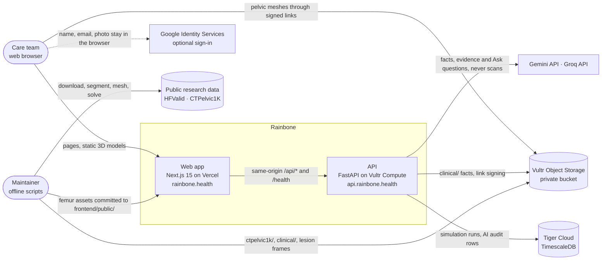
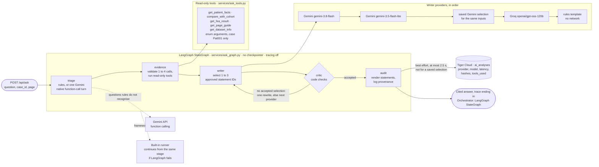
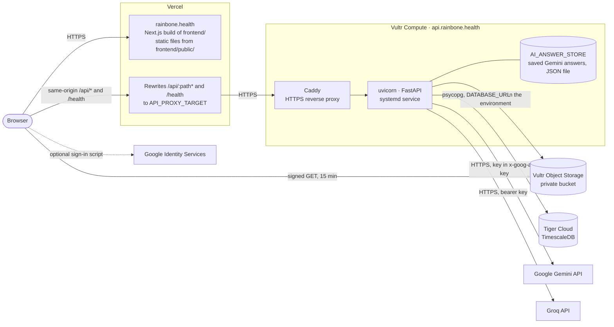
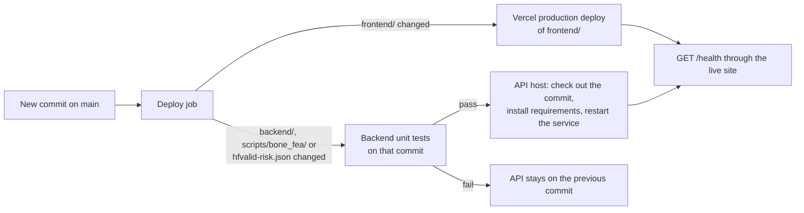
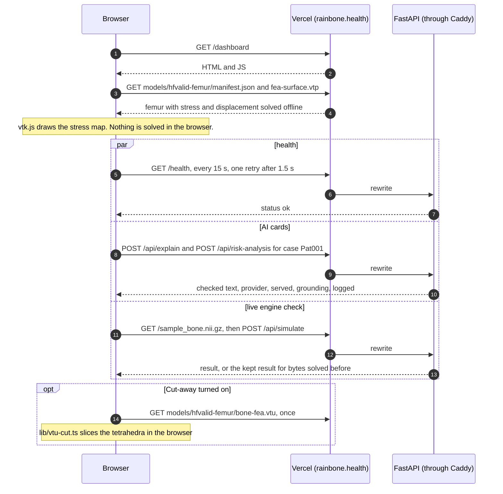
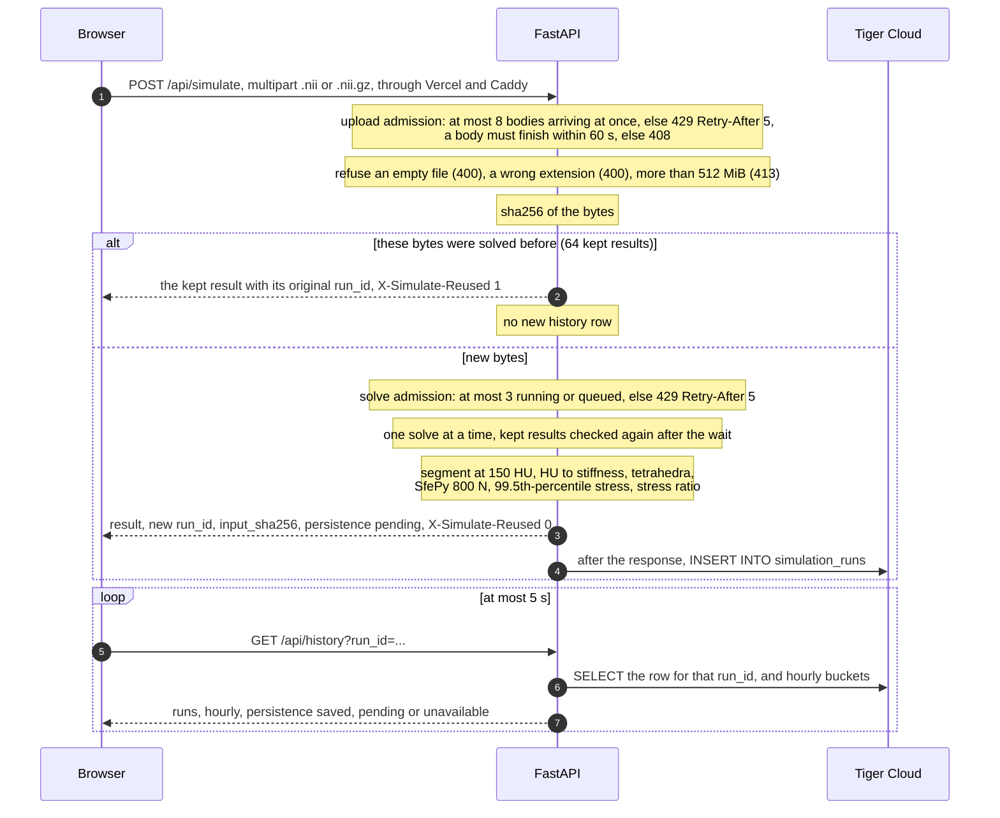
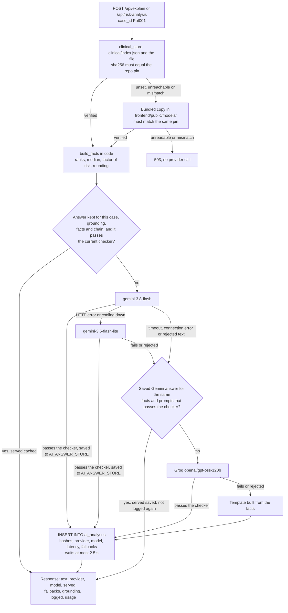
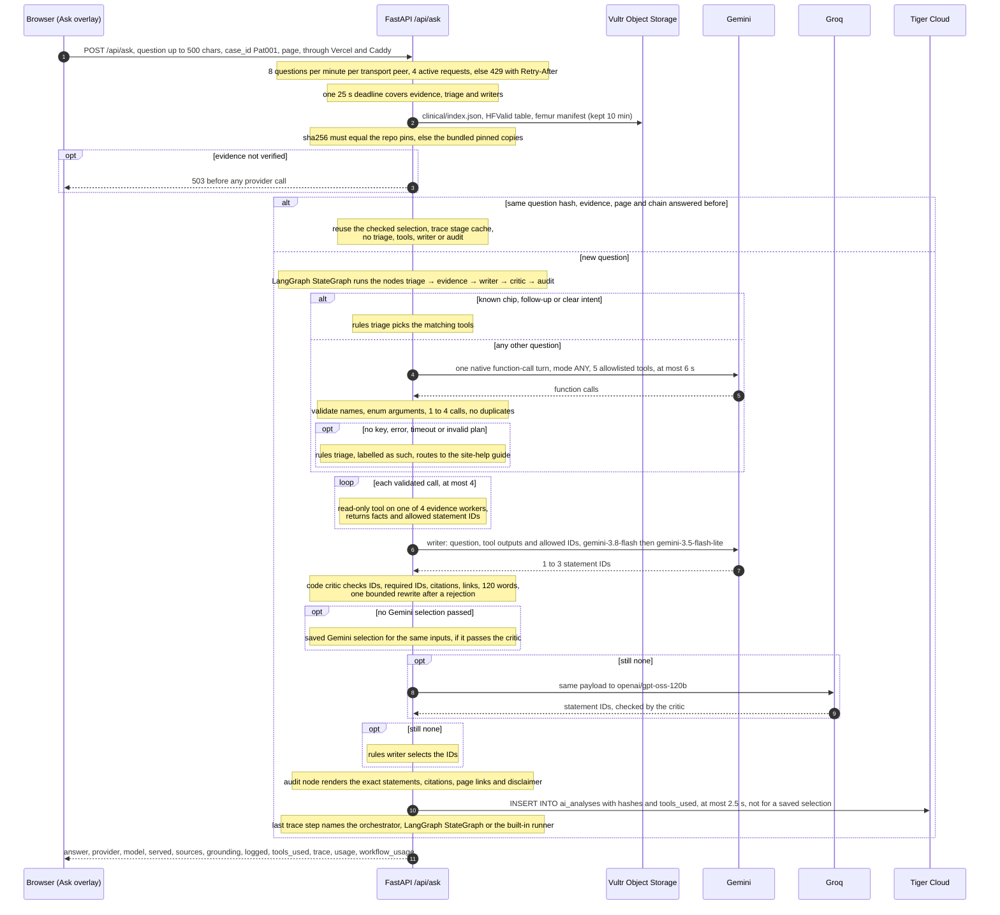
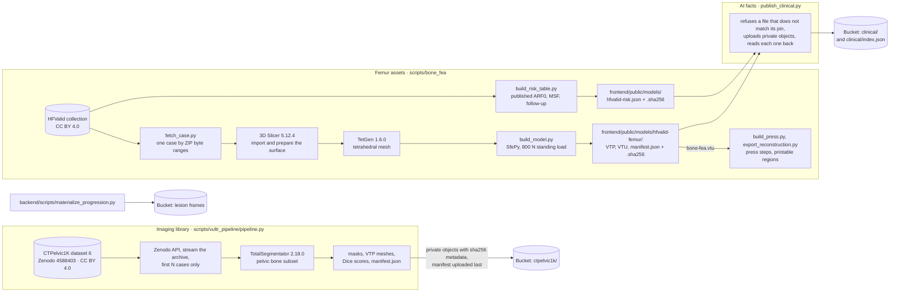
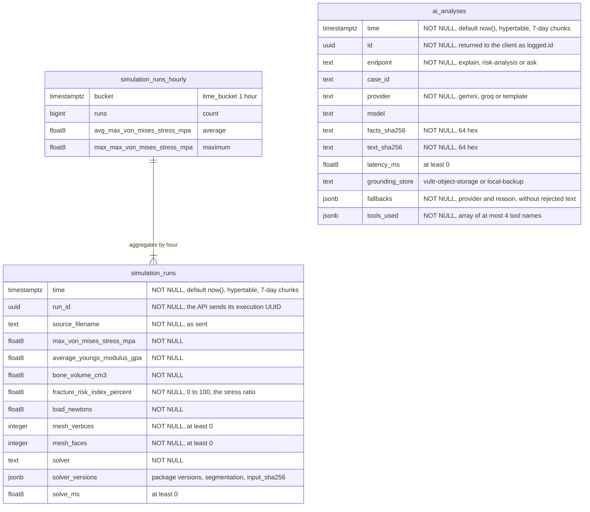

# Rainbone architecture

How the system behind <https://rainbone.health> is built and how data moves through it. This file
describes the code on `main`. The product overview, live routes, API table and local setup are in
[README.md](README.md); request and response fields, checker rules and tests are in
[backend/README.md](backend/README.md). The method, with its equations, is written up as a technical
report at [`/research-paper`](https://rainbone.health/research-paper).

Rainbone is a research prototype built at Hack the Valley 11. It is **not a medical device** and no
output is a clinical measurement.

## Overview

Rainbone is a Next.js web app on Vercel in front of a FastAPI service on Vultr Compute. The browser
loads a femur from the published HFValid collection whose stress field was solved offline, draws it
with vtk.js, and talks to the API only through same-origin `/api/*` and `/health` rewrites. The API
runs a standing-load finite-element solve (SfePy) on an uploaded NIfTI CT, signs 15-minute links to
CTPelvic1K pelvic meshes in a private Vultr Object Storage bucket, records solver executions and AI
provenance in Tiger Cloud (TimescaleDB), and hosts the AI layer: three endpoints that read
sha256-pinned research facts, compute every number in code, let Gemini (or Groq, or a template) put
those facts into words or select checked statements, check the result in code, and log hashes of what
was produced. The third endpoint, Ask Rainbone, is an AI agent pipeline of five stages (triage,
evidence, writer, critic, audit) orchestrated as a LangGraph `StateGraph`. Offline scripts build the
static femur assets and publish the bucket contents.

## Components

### Front end

Next.js 15 App Router, React 19, Tailwind and vtk.js, built from `frontend/` and served by Vercel.

- **Pages.** Landing `/`, `/enter` (guest pass or optional Google sign-in; `/login` redirects there),
  `/privacy`, and the six workspace pages `/dashboard`, `/physics-simulations`, `/bones`,
  `/lesion-progression`, `/datasets` and `/preferences` (`frontend/app/`). The sidebar's Workspace
  group also links `/research-paper`, a technical report with 69 numbered MathML equations, a
  LangGraph state-machine figure and a French résumé; `/physics-simulations/report` is a printable
  simulation report built from the same press manifest the 3D view loads.
- **3D viewers.** `BoneViewer.tsx` draws the HFValid femur stress map; its cut-away fetches the
  tetrahedral `bone-fea.vtu` once and slices it in the browser (`lib/vtu-cut.ts`).
  `physics-simulations.tsx` and `press-viewer.tsx` replay the precomputed press steps.
  `CloudBones.tsx` downloads CTPelvic1K meshes through signed links and compares each file's
  SHA-256 (Web Crypto) with the manifest before drawing it. `lesion-progression.tsx` loads eight
  cached frames from the API. `progression-viewer.tsx` smooths each voxel-derived VTP frame for
  display only (vtk.js CleanPolyData → WindowedSincPolyDataFilter, 10 iterations, pass band 0.1 →
  PolyDataNormals), caches it per frame, and loads a frame once the slider has settled (220 ms);
  frame data and metrics are unchanged.
- **Static assets** in `frontend/public/`: the femur FEA (`models/hfvalid-femur/`), press steps
  (`models/femur-press/`), printable reconstruction (`models/femur-reconstruction/`), the HFValid
  table `models/hfvalid-risk.json`, a `.sha256` pin next to each file the AI layer reads, and
  `sample_bone.nii.gz` (a synthetic test volume, not anatomy).
- **API client.** `lib/api.ts` puts a time limit on every call: 90 s for a simulation, 5 s for
  `/health` and `/api/history`, 35 s for each AI card. `lib/ask-rainbone.ts` posts Ask questions
  and validates the response shape, sources, grounding and log identity before display.
- **Discovery.** Per-route metadata (`lib/seo.ts`), `robots.txt` and `sitemap.xml` (`app/robots.ts`,
  `app/sitemap.ts`), `public/llms.txt`, and a JSON-LD FAQ on the landing page (`lib/site-content.ts`).
- **Proxy.** `next.config.ts` rewrites `/api/:path*` and `/health` to `API_PROXY_TARGET` when it is
  set, so production calls stay on the site's own origin.
- **Browser-only state.** Preferences, dashboard layout, the notification marker and the optional
  Google identity live in `localStorage` (`lib/preferences.ts`, `components/overview-layout.tsx`,
  `components/header-notifications.tsx`, `lib/google-identity.ts`).

### API

One FastAPI app (`backend/main.py`) run by uvicorn. Configuration comes from the process environment
over `backend/.env` (`services/settings.py`).

| Route | File | Responsibility |
|---|---|---|
| `GET /health` | `main.py` | Liveness |
| `POST /api/simulate` | `main.py` | Upload admission, sha256 result cache, one solve at a time, background history save |
| `GET /api/history` | `routes_history.py` | Exact execution by `run_id`, or latest runs, plus hourly buckets |
| `GET /api/bones` | `routes_bones.py` | Read `ctpelvic1k/manifest.json`, sign a 15-minute GET link per listed file |
| `GET /api/progression/coordinates`, `GET`/`HEAD /api/progression/frames/{0-7}.vtp` | `routes_progression.py` | Lesion annotation points and cached frames |
| `POST /api/explain` | `routes_explain.py` | AI layer: plain-words card |
| `POST /api/risk-analysis` | `routes_risk.py` | AI layer: fracture risk card from the published HFValid table |
| `POST /api/ask` | `routes_ask.py` | AI layer: Ask Rainbone, with rate and concurrency limits |
| `GET /api/ai-log` | `routes_ai_log.py` | Latest `ai_analyses` rows, without text |

CORS allows `http://localhost:3000`, `https://rainbone.health` and `https://www.rainbone.health`
by default (`CORS_ALLOW_ORIGINS` overrides), `GET` and `POST` only, and exposes
`X-Simulate-Reused` and `Retry-After`.

### Solver

`backend/services/fea_solver.py`, which loads `scripts/bone_fea/solve.py` by path so the API and the
offline femur model share one SfePy solver.

1. Parse the NIfTI header first and refuse more than 512³ voxels or more than 1 GiB decompressed
   (uploads themselves are capped at 512 MiB).
2. Segment the largest face-connected component at or above 150 HU, with FSL when `FSLDIR` is set
   (`services/fsl_segmentation.py`), otherwise with NumPy/SciPy.
3. Map HU to a Young's modulus bounded to 10–25 GPa, coarsen to at most 8,000 FE voxels, split each
   voxel into tetrahedra.
4. Solve linear elasticity under 800 N (Poisson ratio 0.3), clamp one end band, load the other.
5. Report the 99.5th-percentile von Mises stress over the bone volume, the mean modulus, the bone
   volume, mesh counts, and a stress ratio: that stress divided by an assumed 150 MPa strength,
   clipped to 0–100 %. The ratio is illustrative and is not a fracture probability.

Boundary-face extraction in `scripts/bone_fea/` can use an optional C++23 kernel (C++20, then C++17
fallback): 6.26× faster than NumPy locally and 15.5–16.1× on the production API host; if it can't be
built, the NumPy path runs ([benchmark](scripts/bone_fea/README.md#optional-native-surface-extraction)).

The static HFValid femur on the dashboard was solved offline with one uniform modulus (10 GPa,
ν 0.3) and the same 800 N load (`scripts/bone_fea/README.md`). Its stress ratio uses the peak of
the nodal-averaged von Mises stress, 15.83 MPa, over the same assumed 150 MPa: 10.55 %, shown as
11 %.

### Storage

A private Vultr Object Storage bucket, reached with boto3 and the `VULTR_S3_*` keys.

| Prefix | Written by | Read by |
|---|---|---|
| `ctpelvic1k/` (masks, VTP meshes, `manifest.json`) | `scripts/vultr_pipeline/pipeline.py` | `routes_bones.py` signs links; the browser downloads |
| `clinical/` (`index.json`, `hfvalid/hfvalid-risk.json`, `hfvalid/pat001-femur-manifest.json`) | `scripts/vultr_pipeline/publish_clinical.py` | `services/clinical_store.py` for the AI layer |
| Lesion-progression prefix (`VULTR_BUCKET_PATH`): source volumes, lesion coordinates, cached frames | Cached frames: `backend/scripts/materialize_progression.py` | `services/storage.py`, `services/progression_mesh.py` |

`clinical_store.get_clinical_json()` accepts a `clinical/` object only when its `index.json` entry's
sha256 equals the pin committed next to the bundled copy and the object's bytes hash to that pin.
Otherwise it answers from the bundled copy in `frontend/public/models/`, which must match the same
pin, and reports `grounding.store = "local-backup"` with the reason.

### Database

Tiger Cloud (TimescaleDB), reached with psycopg through `DATABASE_URL`. Two hypertables and one
continuous aggregate (see [Data model](#data-model)). `services/history.py` saves and reads
simulation runs; `services/ai_log.py` writes and reads the AI audit log. The schema is applied only
by `python -m services.history migrate`, which runs every file in `backend/migrations/` in name
order under an advisory lock. Nothing runs at API start, and the API serves without a database:
history and the AI log then answer 503 and nothing is saved.

### AI layer

All three AI endpoints run inside the FastAPI process and share provider configuration, cooldowns
and logging.

| Concern | File |
|---|---|
| Grounding: read `clinical/` facts with sha256 pins, bundled fallback | `services/clinical_store.py` |
| Plain-words card: facts, checker, template | `services/explain.py` |
| Fracture risk card: facts, checker, template | `services/risk.py` |
| Ask Rainbone: evidence catalogue, the five stage functions, writer chain, code critic | `services/ask.py` |
| Ask orchestration: LangGraph `StateGraph` of the five stages, built-in fallback runner | `services/ask_graph.py` |
| Ask triage: one native Gemini function-call turn | `services/ask_triage.py` |
| Ask tools: five allowlisted read-only evidence tools | `services/ask_tools.py` |
| Gemini and Groq adapters, cooldowns, answer cache, saved Gemini answers | `services/llm_providers.py` |
| Audit log in Tiger | `services/ai_log.py` |

The provider chain is `gemini-3.8-flash` → `gemini-3.5-flash-lite` → the Gemini answer saved earlier
for the same facts and prompts → Groq `openai/gpt-oss-120b` → a deterministic template.
`AI_CHAIN` reorders or shortens it (the template is always last) and `AI_OFFLINE=1` leaves only
the template. No model computes a number and
no model receives a scan or a file name; the risk card also keeps our own FE numbers out of the model
input. ARF0 in the risk card is the HFValid authors' published model estimate for subject Pat001,
not a figure Rainbone computes.

#### Ask Rainbone agent pipeline

`ask.py` defines five stage functions and `ask_graph.py` runs them as nodes of a LangGraph
`StateGraph` (`langgraph==1.2.16`). The edges are fixed except one: after the critic, a conditional
edge returns to the writer (one rewrite after a rejection, otherwise the next provider) or goes on to
audit. The graph state holds only the name of the next stage; no question text, credentials or
evidence pass into LangGraph. The graph has no checkpointer and runs inside
`tracing_context(enabled=False)` with no callbacks. If the framework fails, a built-in runner
continues from the same stage without replaying finished ones; an error raised by a stage is passed
on unchanged. The trace's last step names the orchestrator: `Orchestrator: LangGraph StateGraph` or
`Orchestrator: built-in (LangGraph unavailable)`.

### Authentication and identity

There are no server accounts and the API has no authentication. `/enter` offers a demo profile or
optional "Sign in with Google" (Google Identity Services, enabled by `NEXT_PUBLIC_GOOGLE_CLIENT_ID`).
The ID token is decoded in the browser for a name, email and photo, never verified and never sent to
the API (`frontend/lib/google-identity.ts`). Google's button sets its own `g_state` cookie.

## Deployment view

Apart from Google's optional sign-in script and profile photo, the CTPelvic1K meshes are the only
thing the browser downloads from outside the site's origin. The API needs the whole repository on its host, because it imports the solver from `scripts/bone_fea/`
and reads the bundled pinned copies from `frontend/public/models/`.

Production is deployed from `main` by a deploy job kept outside this repository (there is no CI
workflow here). For a new commit it does the following:

## Data flows

### 1. Page load (`/dashboard`)

The sample run is on by default and can be turned off in Preferences. When `/health` comes back
after being unreachable, the page asks again for any AI card that was unavailable.
`/physics-simulations` calls no API; `/bones` calls `GET /api/bones` and then the bucket;
`/datasets` reads `/health`, `/api/bones`, `/api/history` and, each minute while visible,
`/api/ai-log?limit=8`.

### 2. Simulate upload (`POST /api/simulate`)

A volume the solver cannot read, segment or mesh returns 422. A save that fails is logged and marks the run
`unavailable`; it never fails the simulation. The browser shows a run as saved only after the
returned `run_id` (and `input_sha256` when present) matches a stored row. Uploaded results appear in
their own panel and never replace the Pat001 reference femur or its published measures.

### 3. AI card request (`POST /api/explain`, `POST /api/risk-analysis`)

Both cards follow the same steps; the README has the full
[sequence for one risk-analysis request](README.md#ai-flow-one-risk-analysis-request). The plain-words
card reads `clinical/hfvalid/pat001-femur-manifest.json`; the risk card reads
`clinical/hfvalid/hfvalid-risk.json`.

A provider without a key is skipped with the reason in `fallbacks`. Each model answer also returns
`usage`, the token counts the provider reported for the call that wrote it (null for the template);
tokens are not written to the audit log. Kept answers live in memory
(Gemini 1 h; Groq and template 60 s; at most 60 s when `DATABASE_URL` is set but the Tiger row was
not written), and
concurrent equal requests share one chain run.

### 4. Ask Rainbone request (`POST /api/ask`)

The diagram's triage, tool loop, writer attempts, critic and audit are the five LangGraph nodes
described under [Ask Rainbone agent pipeline](#ask-rainbone-agent-pipeline); the loop from the critic
back to the writer is the graph's conditional edge. The five tools are `get_patient_facts`,
`compare_with_cohort`, `get_fea_result`, `get_page_guide` and `get_dataset_info`. Their arguments are enums (`case_id` can only be `Pat001`), so no call can
select an arbitrary case, file, URL or SQL. Besides the question and the page, the writer sees only
the executed tools' outputs and the statement IDs they allow, and the model never writes prose: the
server renders statements from a fixed catalogue. Each request is independent; prior turns and
uploaded scans are not sent. The trace arrives with the completed response and lists only stages
that ran. `usage` holds the accepted writer's provider-reported tokens; `workflow_usage` adds up the
tokens providers reported for the triage and writer generations this request started, rejected
selections included, and is marked incomplete when a report is missing or an attempt failed. A
cached or joined request reports no new work. Neither is written to the audit log, and neither is a
billing total.

### 5. Offline data pipelines

All of these run by hand. The femur assets and their pins are committed, so the front end and the
API's bundled fallback come from the same files; `publish_clinical.py` copies exactly those bytes to
the bucket. ARF0 and MSF are extracted from the HFValid metadata as published and are not recomputed.
The CTPelvic1K masks and meshes are automatic segmentations, not clinically reviewed.

## Data model

Defined in `backend/migrations/` (Tiger Cloud, TimescaleDB). There are no primary keys, foreign keys,
retention or compression policies; rows stay until deleted by hand.

- **`simulation_runs`** (`001_simulation_runs.sql`): one row per new successful solver execution.
  A cached repeat adds no row. Index `(source_filename, time DESC)`. The input hash is kept inside
  `solver_versions` (`services/history.py`), so it needed no schema change; older rows have none.
- **`simulation_runs_hourly`** (`001_simulation_runs.sql`): a real-time continuous aggregate
  (`materialized_only = false`) with an hourly refresh policy for buckets between 30 days and 1 hour
  old; newer rows are read from the hypertable at query time. It counts executions, not change in
  any person.
- **`ai_analyses`** (`002_ai_analyses.sql`, `003_ai_tools.sql`): one row per answer a model or the
  template produced. Index `(endpoint, time DESC)`. For Ask, `facts_sha256` hashes the request,
  evidence and tool-output identity, and `text_sha256` hashes the rendered answer. The answer text,
  the facts, the question, tool arguments and tool outputs are not stored.

## Reliability and safety

### Limits, caches and timeouts

All state below is in memory and belongs to one API process.

| Mechanism | Value | Where |
|---|---|---|
| Upload bodies arriving at once | 8; 429 with `Retry-After: 5`; 60 s per body, else 408 | `backend/main.py` |
| Upload size | 512 MiB (413); at most 512³ voxels and 1 GiB decompressed | `services/fea_solver.py` |
| Uncached solves | 3 running or queued, 1 running; 429 with `Retry-After: 5` | `backend/main.py` |
| Simulation results | 64 kept by sha256 of the bytes, least recently used first out | `backend/main.py` |
| Ask admission | 8 per minute per transport peer; 4 active requests; 4 pending generations; 4 evidence workers | `routes_ask.py`, `services/ask.py` |
| Ask budget | 25 s for evidence, triage and writers; triage at most 6 s; at most 4 tool calls; 1 to 3 statements; 120 words; 500-character question | `services/ask.py`, `ask_triage.py`, `ask_tools.py` |
| AI answer caches | 256 entries each for explain and risk, 128 for Ask; Gemini 1 h, Groq and template 60 s, saved answers at most 60 s, unlogged answers at most 60 s | `llm_providers.py`, `ask.py`, `ai_log.py` |
| 429 memory | a model is skipped 300 s after HTTP 429 and 60 s after a timeout, connection error or other HTTP error (a rejected text starts no cooldown), by every AI route | `llm_providers.py` |
| Gemini keys | HTTP 400, 401 or 403 moves to the next configured key (`GEMINI_API_KEY`, then `GEMINI_API_KEYS`) and skips that key for 60 s; a 429 is never retried with another key | `llm_providers.py` |
| Provider timeouts | Gemini 10 s per key, Groq 8 s, connect at most 3 s | `llm_providers.py` |
| Saved Gemini answers | JSON file, at most 500 entries, written by atomic rename | `llm_providers.py` |
| `clinical/` reads | kept 10 min, 60 s after a fallback; 1 s connect, 1.5 s read, one attempt; 4 MiB cap; concurrent misses share one read | `clinical_store.py` |
| Bone manifest | kept 30 s; links valid 15 min; concurrent reads share one request | `routes_bones.py` |
| AI audit write | 2 s connect, 1.5 s statement, 2.5 s total wait; skipped for 60 s after a failure | `ai_log.py` |
| History database | 5 s connect, 3 s statement, 1 s lock timeout | `history.py` |
| Browser | 90 s simulate, 5 s health and history, 35 s per AI card; health every 15 s; save read-back at most 5 s | `frontend/lib/api.ts`, `frontend/app/dashboard/page.tsx`, `frontend/lib/simulation-history.ts` |

### Fallbacks

- **Facts:** bucket → bundled pinned copy → 503. Every response says where its facts came from in
  `grounding`.
- **Explanation cards:** `gemini-3.8-flash` → `gemini-3.5-flash-lite` → saved Gemini answer → Groq →
  template. The template needs no network and passes its checker for every valid request; if it ever
  did not, the request fails rather than show unchecked text.
- **Ask:** rules triage for recognised intents, native Gemini triage otherwise, rules triage if that
  fails. Writers follow the same provider chain and end with a rules writer. If LangGraph fails, a
  built-in runner continues from the same stage and the trace says `Orchestrator: built-in
  (LangGraph unavailable)`.
- **Database:** an unset or failing database never fails a simulation or an AI answer; the response
  reports `persistence: "unavailable"` or `logged: null`, and the UI claims a save only when the API
  confirms it.

### Checks on model output

- **Plain-words card** (`services/explain.py`): every number must be a fact or a fact rounded to 0, 1
  or 2 decimals, and a number with a unit must be that unit's fact. Spelled-out quantities, a blocked
  wording list (clinical judgement, advice, fracture, risk, safety and similar terms), JSON field
  names read aloud and text over 700 characters are rejected.
- **Risk card** (`services/risk.py`): the same number rule, plus each number must be the right kind of
  quantity (a percent only for ARF0 figures, newtons only for forces, a count only for women). It
  rejects ranks stated the wrong way round, time-horizon wording, "chance", "probability",
  "likelihood" and certainty wording, advice and treatment terms, wording that places the recorded fracture at the
  hip (the follow-up does not record where), and text over 600 characters.
- **Ask critic** (`services/ask.py`): 1 to 3 distinct IDs in the expected format, each from the
  executed tools; `unavailable` only on its own; the required IDs for a recognised intent (a question
  about whether she will fracture must include the research-limitation statement, the recorded
  follow-up outcome and ARF0); at most 120 rendered words; citations and page links only from the
  fixed catalogue.
- **Cut-off replies:** a Gemini reply that ends for any reason other than `STOP` (including the token
  limit) and a Groq reply cut at its length limit are rejected, so partial text is never shown.
- **Kept answers** are checked again against the current checker before reuse.

These checks catch explicit failure patterns with rules; they are not semantic verification or
clinical validation, and accepted text still needs human review.

## Security and privacy

| Data | Where it goes | Kept |
|---|---|---|
| Uploaded scan bytes | Held by the API for the request (the multipart parser may spool a large body to a temporary file; FSL, when used, works in a temporary folder that is removed) | Not saved. The result numbers are kept in memory by sha256 |
| Simulation result | Tiger `simulation_runs`: file name as sent, numbers, solver versions, input sha256, timing | Until deleted by hand |
| AI card facts and text | Sent to the provider (facts only) and returned to the browser with token usage. Tiger keeps sha256 hashes, provider, model, latency, grounding store, fallbacks; no text and no token counts | Hashes until deleted. Checked Gemini text, its facts and token usage in the saved-answer file, at most 500 entries |
| Ask question | Sent to Gemini (triage and writer) and, as a fallback, Groq. The server keeps only its hash in cache keys and audit rows | Saved-answer file keeps selected statement IDs under hashed identities |
| Google identity | Decoded in the browser, stored in `localStorage` | Until sign-out; never sent to the API |
| Preferences, layout | `localStorage` | Per browser |

- **Private bucket, signed links.** The browser never holds storage credentials. `GET /api/bones`
  signs 15-minute GET links only for manifest paths that pass a strict relative-path pattern under
  `ctpelvic1k/`, and the browser checks each file's sha256 before drawing it.
- **Pinned facts.** A changed or tampered `clinical/` object cannot change what the AI layer says: it
  must match the sha256 committed in this repository, or the API falls back to the bundled copy with
  the same pin.
- **Hashes only in the AI log.** Rejection reasons are stored without the quoted fragment, and Ask
  fallbacks are reduced to fixed categories (such as `rate-limited (HTTP 429)` or `request timeout`),
  so they never keep model output or question fragments.
- **Secrets.** Keys come from the environment or a `.env` file (gitignored) and are never logged or
  returned. Gemini keys travel in a header and appear in reasons only as "key 1", "key 2"; cooldowns
  are keyed by a hash of the key. The database password is masked in log lines, and storage errors
  are logged by error code only.
- **Same-origin calls.** In production the browser calls the site's own origin and Vercel forwards
  `/api/*` and `/health`; CORS on the API allows only the listed origins (or a configured pattern)
  and `GET`/`POST`.
- **Open read endpoints.** `GET /api/history` and `GET /api/ai-log` need no authentication. History
  stores file names exactly as sent, so files should be named without personal details.
- **Research data only.** HFValid (CC BY 4.0) and CTPelvic1K (CC BY 4.0) are de-identified public
  research data; TotalSegmentator is Apache-2.0.

## Known limits

- **Research prototype, not a medical device.** The FEA is illustrative: assumed, uncalibrated
  material properties and a standing load, not a fall. The 11 % (10.55 %) stress ratio is peak stress
  over an assumed 150 MPa strength and is not a fracture probability.
- **One reference case.** The dashboard's AI cards and Ask describe HFValid subject Pat001 only
  (`/api/risk-analysis` accepts any subject ID in the HFValid table, but only Pat001 has a femur
  model, and `/api/explain` and `/api/ask` accept no other case ID). ARF0 and MSF are
  the HFValid authors' published results; importing a CT runs our standing-load solve and produces
  neither. The cohort is 101 women, 4 with a recorded fracture during follow-up.
- **Process-local state.** Caches, cooldowns, admission slots and rate limits belong to one API
  process; there is no distributed queue. One solve runs at a time, and the saved-answer file assumes
  a single process.
- **Client identity behind proxies.** The Ask rate limit is keyed by the transport peer the API sees;
  whether that is the end user depends on the reverse-proxy configuration.
- **Rule-based checks.** The checkers and critic catch listed patterns; they do not prove every
  sentence correct, and the most relevant statement is not guaranteed for every question.
- **No accounts.** The API has no authentication and the read endpoints are public.
- **Lesion progression is a visualisation.** Its intermediate frames are interpolated, not measured.
- **Operations outside the repository.** Deploy automation is not versioned here, and migrations are
  applied by hand with `python -m services.history migrate`.
