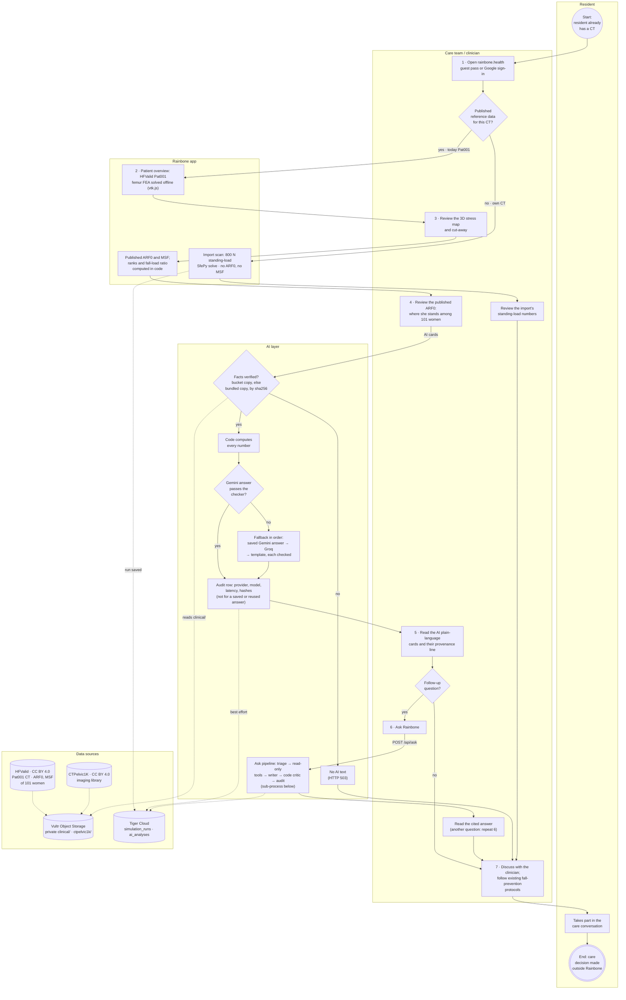
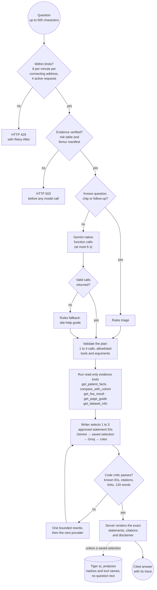
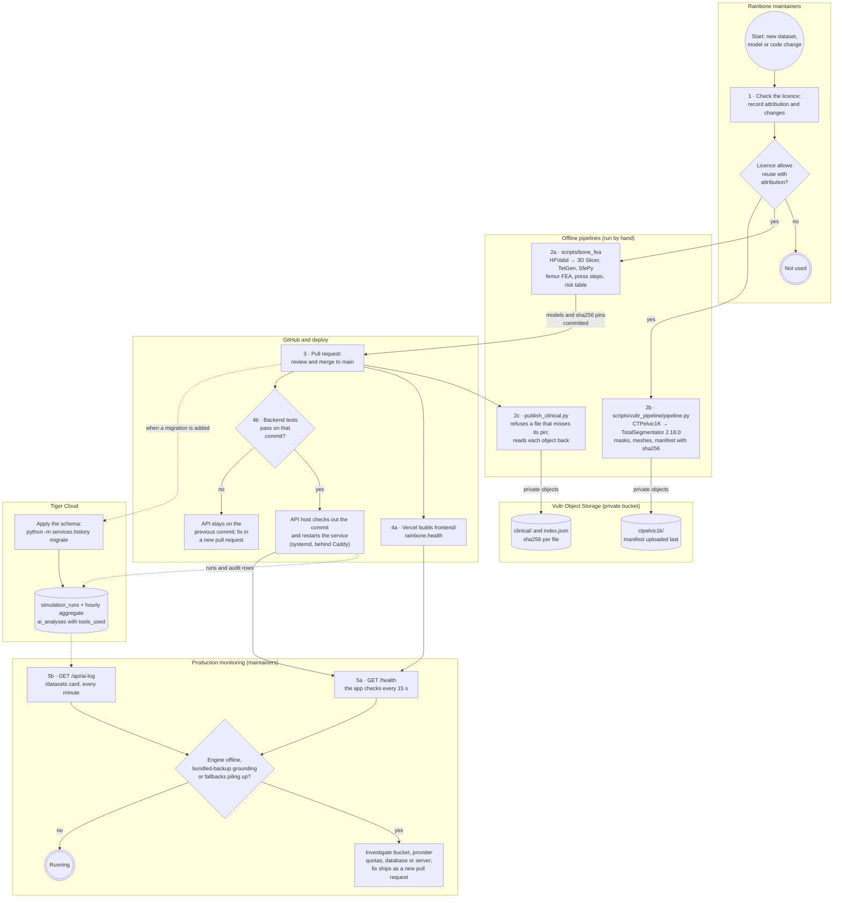

# Business process flow

This document describes how Rainbone is meant to be used by a care team in senior living,
and the data and operations process that keeps the live app at <https://rainbone.health>
running. The system itself is described in [ARCHITECTURE.md](ARCHITECTURE.md) and
[README.md](README.md#architecture).

Rainbone is a research prototype built at Hack the Valley 11, **not a medical device**. It
gives no diagnosis, no forecast and no advice. The fracture-risk figure it shows (ARF0) is
the HFValid study authors' published model estimate, and its own finite-element analysis is
illustrative. Everything below describes intended use and how the prototype supports it
today. Nothing here has been tested in a care setting.

## What runs today, and what is intended

| Intended use | What the live app does today |
|---|---|
| Start from a CT the resident already has | The demo runs on one published research CT: HFValid case Pat001, a woman aged 78 at the scan. The `/bones` imaging library shows CTPelvic1K pelvic meshes. |
| Show how her femur carries load | A complete femur from Pat001, solved offline with SfePy under an 800 N standing load and coloured by von Mises stress, with a cut-away view. |
| Put her fall-related numbers in context | The HFValid authors' published ARF0 and minimum sideways-fall strength (MSF) for Pat001, ranked against all 101 women in the study. Rainbone computes the ranks; it does not compute ARF0 or MSF. |
| Use the resident's own CT | **Import scan** runs Rainbone's 800 N standing-load solve on a `.nii` or `.nii.gz` file and shows its numbers in their own panel. It produces no ARF0 and no MSF, and the AI cards keep describing Pat001. |
| Explain the numbers in plain language | Two AI cards and Ask Rainbone, all grounded in sha256-verified facts, checked by code, and logged in Tiger Cloud (best effort). |
| Decide what to do | Outside Rainbone. The care team and clinician follow the facility's existing fall-prevention protocols. |

## Actors and swimlanes

| Lane | Who or what | Part in the process |
|---|---|---|
| Resident | The person whose CT is reviewed. In the demo this is HFValid Pat001, a research subject, not a Rainbone user. | Already has a CT; takes part in the care conversation. |
| Care team / clinician | Care staff and the responsible clinician in a senior-living home. | Open the dashboard, review the evidence, ask follow-up questions, make care decisions with existing protocols. |
| Rainbone app | Next.js front end on Vercel (`rainbone.health`), FastAPI back end on Vultr Compute (`api.rainbone.health`). | Shows the 3D stress map, the published measures and the import solve. |
| AI layer | The AI endpoints inside the FastAPI process: `/api/explain`, `/api/risk-analysis`, `/api/ask`. | Reads verified facts, has a model word them, checks the result, records an audit row. |
| Data sources | HFValid (CC BY 4.0), CTPelvic1K (CC BY 4.0, meshes made with TotalSegmentator, Apache-2.0), Vultr Object Storage, Tiger Cloud (TimescaleDB). | Supply the research data, hold the verified copies, keep the history and the audit log. |

## 1. Care review process

### Steps

| Step | Lane | What happens | Where it lives |
|---|---|---|---|
| 1 | Care team | Enter through `/enter`: a guest pass for the demo seat (Dr. Rowan), or Sign in with Google when it is configured. The Google name, email and photo stay in the browser (`localStorage`); there are no server accounts. | `frontend/app/(landing)/enter`, `frontend/lib/google-identity.ts`, `/privacy` |
| 2 | Rainbone app | Patient overview (`/dashboard`) loads the HFValid Pat001 femur with the stress and displacement fields solved offline. Nothing is solved in the browser. The page checks `GET /health` every 15 s. | `frontend/components/BoneViewer.tsx`, `dashboard.tsx` |
| 3 | Care team | Rotate the femur, turn on Cut-away and set the depth to see stress inside the bone. The standing-load stress ratio is 11 % (10.55 %): peak stress 15.83 MPa divided by an assumed 150 MPa strength. It is not a fracture probability. | `frontend/public/models/hfvalid-femur/manifest.json`, `backend/services/explain.py` |
| 4 | Care team | Read the published measures on the risk-analysis card. ARF0 is 47.1 %, higher than 56 of the 101 women (study median 44.3 %; the 4 women with a fracture recorded during follow-up had 53.7–73.2 %). MSF is 1,339 N, weaker than 75 of the 101. A sideways fall loads the hip with 2.90–4.26 kN (van den Kroonenberg 1995), 2.17–3.18 times that strength. | `frontend/public/models/hfvalid-risk.json`, `backend/services/risk.py` |
| 5 | AI layer, then care team | The dashboard requests `POST /api/explain` and `POST /api/risk-analysis`. Under each card a provenance line says where the facts were read from ("Facts read from Vultr Object Storage · sha256 verified", or the bundled backup copy with the reason) and "Logged in Tiger Cloud" when the audit row is confirmed. The card label names the model, a saved Gemini answer, the Groq backup or "Offline summary (no AI)". | `frontend/components/grounding-line.tsx`, `frontend/lib/ai-label.ts` |
| 6 | Care team, AI layer | Ask Rainbone (header button, `/` key, or **Ask a follow-up** on either card) answers from approved, cited source statements. See the sub-process below. | `frontend/components/ask-rainbone.tsx`, `backend/services/ask.py` |
| 7 | Care team, clinician, resident | The conversation and any action happen outside Rainbone, under the facility's existing fall-prevention protocols. Rainbone has no connection to a care record system and stores no care decision. | — |
| Import | Care team, Rainbone app | **Import scan** posts a `.nii` or `.nii.gz` (at most 512 MiB) to `POST /api/simulate`. The API keeps the largest connected region at or above 150 HU, maps HU to stiffness, solves an 800 N compression with SfePy and returns the 99.5th-percentile stress, mean stiffness, bone volume and the stress ratio. The file itself is not saved; the file name and results are saved to `simulation_runs` in Tiger Cloud when the database is reachable. | `backend/main.py`, `backend/services/fea_solver.py`, `backend/services/history.py` |

### Decision points

| Gateway | Yes | No |
|---|---|---|
| Published reference data for this CT? | Today only HFValid Pat001 has it: the published ARF0, MSF and follow-up. | Import the CT for the standing-load solve only. No ARF0, no MSF, no AI card for the import. |
| Facts verified? | The `clinical/` copy in Vultr Object Storage matches the sha256 listed in `clinical/index.json` and pinned in the repository. | The bundled copy is used if it matches its pin, and the card says why. If it does not match either, evidence is unavailable and no AI text is generated (HTTP 503). |
| Gemini answer passes the checker? | `gemini-3.8-flash`, then `gemini-3.5-flash-lite`. The checker accepts only numbers that are facts and rejects blocked wording such as advice, diagnosis, statements about the future, or "chance" and "probability" for ARF0. | Fallback in order: the Gemini answer saved earlier for exactly the same facts and prompts (if it still passes the checker), Groq `openai/gpt-oss-120b`, then a deterministic template that needs no network. |
| Follow-up question? | Ask Rainbone. | Go to the discussion with the clinician. |

### Ask Rainbone sub-process

- **Bounded, not autonomous.** The model never writes free prose here. It chooses tools from a
  fixed list with fixed argument values (only case `Pat001`), and the writer picks statement IDs
  from the outputs of the tools that ran. The server renders those exact statements with their
  citations and links, and adds "Research prototype; not a medical device or medical advice."
- **Personal medical questions** (diagnosis, treatment, medication, "my risk", "should I") go to
  a fixed statement saying Rainbone answers only questions about its own data and pages.
  Questions about whether or when she will fracture get the research limitation, the recorded
  Pat001 follow-up outcome and the published ARF0, never a forecast.
- **Privacy.** Each question is sent on its own, without earlier turns or uploaded scans. The
  conversation lives only in the page's memory. Tiger Cloud and the saved-answer file store
  hashes, statement IDs and tool names, never the question text. The privacy page asks users
  not to put personal or medical information in questions.
- **Reuse.** An identical question over the same evidence can be answered from the in-memory
  cache (128 answers); it is re-checked and not logged again.

## 2. Data and operations process

| Step | What happens | Control |
|---|---|---|
| 1 · Licence | HFValid and CTPelvic1K are CC BY 4.0; TotalSegmentator is Apache-2.0. The README's data section and the CTPelvic1K manifest carry the licence, the source and a note of what was changed; the femur manifest and `clinical/index.json` carry the licence and the source. | Attribution travels with the data and is shown in the app (`/bones`, `/datasets`, the AI card sources). |
| 2a · Femur model | `scripts/bone_fea` imports Pat001 into 3D Slicer, meshes it with TetGen, solves it with SfePy and writes `frontend/public/models/`; `build_risk_table.py` extracts the ARF0 and MSF table from the dataset's published metadata. | The femur manifest records the sha256 of each output file, and the two files the AI layer reads (the femur manifest and the risk table) each have a `.sha256` pin committed next to them. |
| 2b · Imaging library | `pipeline.py` reads file sizes and checksums from the Zenodo API, runs TotalSegmentator, writes meshes and a manifest, and uploads them under `ctpelvic1k/` as private objects with their sha256; the manifest goes last. | The API hands out 15-minute pre-signed links, and the browser checks each mesh's sha256 before drawing it. |
| 2c · AI facts | `publish_clinical.py` uploads the risk table and the femur manifest under `clinical/` with `clinical/index.json`. | A file that does not match its pin in the repository is refused; every object is read back and hashed. The API repeats both checks whenever it reads from the bucket. |
| 3 · Change | Code, models and pins reach `main` through pull requests. | Backend and front-end test suites live in `backend/tests/` and `frontend/tests/`. |
| 4 · Deploy | Production is deployed from `main` by a deploy job kept outside this repository: Vercel deploys the front end, and the backend tests run on the new commit before the API host checks it out and restarts the service. If they fail, the API stays on the previous commit. Details in [ARCHITECTURE.md](ARCHITECTURE.md#deployment-view). | The browser reaches the API only through `rainbone.health`, which forwards `/api/*` and `/health` to `api.rainbone.health`. |
| 5 · Monitor | `GET /health` shows the engine status in the app; `GET /api/ai-log` shows the latest AI answers with provider, model, latency, grounding store, fallbacks and tools, without their text. | A run of `local-backup` grounding or of fallbacks to Groq or the template is the signal to check the bucket, the provider quotas or the database. |

## Value

### Who benefits

- **Care staff** get one shared picture of a femur under load and of where a published
  fracture-risk estimate sits among 101 women, in plain words.
- **Clinicians** get the source of every number: the published study, the illustrative
  simulation, and whether the facts came from the verified bucket copy or the backup.
- **Residents and families** may get a clearer conversation, because the explanation is written
  for a non-specialist and keeps to what the data shows.
- **Whoever audits the system** gets a row in Tiger Cloud for each newly generated AI answer and
  a public, text-free AI log, so the provider, model, fallbacks and grounding of an answer can be
  traced.

### What changes

| Before | With Rainbone (intended) |
|---|---|
| A published fracture-risk estimate is a bare percentage in a paper. | It is shown with its rank among 101 women, the study median and the range of the 4 women with a recorded fracture. |
| A CT shows anatomy, not load. | A 3D stress map shows where a real femur carries the most stress under a standing load. |
| An AI summary is hard to check. | Every number is computed in code, checked after generation, tied to a sha256-verified source and logged. |

### What it does not do

- It gives no diagnosis, no forecast and no treatment or prevention advice.
- It does not compute ARF0 or MSF from an imported CT; imports get the standing-load solve only.
- Its own simulations are illustrative. The Pat001 femur uses one uniform, uncalibrated
  stiffness, a clamped distal end and 800 N on the femoral head; an imported CT gets an assumed
  HU-to-stiffness mapping and the same 800 N. The stress ratio is not a fracture probability.
- It has not been validated for clinical use, and the cohort is small (101 women, 4 recorded
  fractures).
- It has no server accounts and no link to a care record system. Simulation history and the AI
  log are readable by anyone, and history stores file names as sent, so files must not be named
  with patient details.
- Lesion progression (`/lesion-progression`) is an illustrative visualization, not measured
  progression.
- It records no falls, fractures or other outcomes of residents.

## What the audit log records

Each newly generated AI answer adds one `ai_analyses` row in Tiger Cloud, readable through
`GET /api/ai-log` (`backend/migrations/002_ai_analyses.sql`, `003_ai_tools.sql`). A cached or
saved answer adds no row, and a row is written only when the database is reachable.

| Question an operator can answer | Column |
|---|---|
| Which endpoint and case produced the answer? | `endpoint`, `case_id` |
| Was it written by Gemini, Groq or the template, and which model? | `provider`, `model` |
| Were the facts read from the verified bucket copy or the bundled backup? | `grounding_store` |
| Which providers were skipped or rejected first, and why (without the rejected text)? | `fallbacks` |
| How long did the answer take? | `latency_ms` |
| Which evidence tools did Ask Rainbone run? | `tools_used` |
| Which facts and which text were they, without storing either? | `facts_sha256`, `text_sha256` |

The question text, the answer text, the facts, the selected statement IDs and token counts are not
stored.

## Responsibilities

R = responsible, A = accountable, C = consulted, I = informed.

| Activity | Care staff | Clinician | Resident | Rainbone maintainers | What Rainbone does |
|---|---|---|---|---|---|
| Decide to use Rainbone in a review | C | A | I | I | — |
| Open the dashboard; review the stress map and published ARF0 | R | A | — | — | Shows the precomputed femur and the published table |
| Read the AI cards and check their provenance | R | A | — | — | Words verified facts, checks them, labels the source |
| Ask follow-up questions | R | C | — | — | Answers from approved, cited statements only |
| Import a CT (only files they may share, named without patient details) | R | A | I | — | Runs the standing-load solve; saves file name and results |
| Discuss with the resident; apply fall-prevention protocols | R | A | C | — | Nothing; no advice is given |
| Report a wrong or unclear AI answer | R | I | — | A | Provides the AI log row, without the text |
| Dataset licensing and attribution | — | — | — | R, A | Shows attribution in the app |
| Offline processing and publishing to Vultr with sha256 | — | — | — | R, A | Refuses data that does not match its pin |
| Deploy | — | — | — | R, A | The deploy job runs the backend tests before the API restarts |
| Monitor `/health` and the AI log | I | — | — | R, A | Shows engine status and the latest AI answers |

## Sources

- System and AI layer: [README.md](README.md), [`backend/README.md`](backend/README.md)
- Care flow: `frontend/app/`, `frontend/components/dashboard.tsx`, `risk-analysis.tsx`,
  `plain-explanation.tsx`, `ask-rainbone.tsx`, `grounding-line.tsx`
- AI layer: `backend/services/risk.py`, `explain.py`, `ask.py`, `ask_triage.py`, `ask_tools.py`,
  `llm_providers.py`, `clinical_store.py`, `ai_log.py`
- Data and history: `backend/migrations/`, `backend/services/history.py`, `backend/routes_bones.py`
- Pipelines: [`scripts/bone_fea/README.md`](scripts/bone_fea/README.md),
  [`scripts/vultr_pipeline/README.md`](scripts/vultr_pipeline/README.md)
