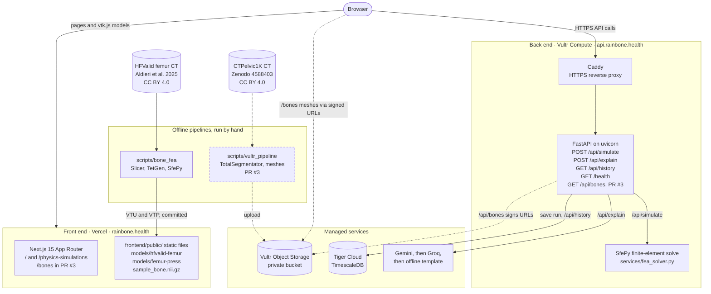

# Rainbone

Rainbone (RainbowBone) shows how a real bone carries load. It runs a finite-element
analysis (FEA) on a complete femur segmented from CT, colours the bone by von Mises
stress in a 3D viewer you can rotate and cut open, reports an illustrative fracture
risk index (peak stress against an assumed 150 MPa bone strength), and explains the
numbers in plain language. A FastAPI back end runs the same kind of solve on an
uploaded CT volume, with each voxel's stiffness taken from its Hounsfield units. It is
a research prototype built at Hack the Valley 11, **not a medical device**: material
properties and loads are assumptions, and no output is a clinical measurement.

## Architecture



Dashed lines and boxes marked PR #3 are in open pull request
[#3](https://github.com/galitau/Rainbone_prod_hackthevalley11/pull/3), not yet on
`main`. The app is live: the front end (built from `frontend/`) on Vercel at
<https://rainbone.health>, and the API on a Vultr Compute instance at
<https://api.rainbone.health>, with Caddy in front of uvicorn. To run both locally, see below.

### What happens when a page loads

The dashboard (`/`):

1. Next.js serves the page and the static files in `frontend/public/`.
2. The 3D viewer (`frontend/components/BoneViewer.tsx`, vtk.js) fetches
   `models/hfvalid-femur/manifest.json` and `fea-surface.vtp`: the HFValid femur with
   the stress and displacement fields that `scripts/bone_fea` solved offline. Nothing
   is solved in the browser. The cut-away view fetches `bone-fea.vtu` once and slices
   its tetrahedra in the browser (`frontend/lib/vtu-cut.ts`) to show the stress inside the bone.
3. The page fetches `sample_bone.nii.gz` (a synthetic test volume, not anatomy) and
   posts it to `POST /api/simulate`.
4. The API keeps voxels at or above 150 HU, maps HU to stiffness, meshes the bone into
   tetrahedra, solves an 800 N compression with SfePy, and returns peak stress, mean
   stiffness, bone volume and the fracture risk index for the metrics panel.
5. After answering, the API saves the run to TimescaleDB (Tiger Cloud) when
   `DATABASE_URL` is set; `GET /api/history` reads the runs back.

Open PR [#2](https://github.com/galitau/Rainbone_prod_hackthevalley11/pull/2) takes the
API address from `NEXT_PUBLIC_API_BASE_URL` (on `main` it is fixed to
`http://127.0.0.1:8000`) and adds three calls on load: `GET /health` (repeated every
15 s), `POST /api/explain` with the femur's numbers for the plain-language card, and
`GET /api/history`. `/api/explain` asks Gemini, then Groq, then falls back to an
offline template; a checker rejects any text containing a number it was not given.

`/physics-simulations` replays a precomputed hydraulic-press loading history of the
same femur (`models/femur-press/manifest.json` and one VTP per load step). It calls
no API.

`/bones` (PR #3, opened from Imaging library) calls `GET /api/bones`. The API reads
the pelvic bone manifest from the private Vultr Object Storage bucket and returns
15-minute pre-signed URLs, so the browser downloads the meshes straight from the
bucket without seeing any credentials.

## Repository layout

| Path | What it holds |
|---|---|
| `package.json` (root) | Shortcuts only: `npm run setup`, `npm run dev`, `npm run build` and `npm start` run the same scripts inside `frontend/` |
| `frontend/app/` | Next.js App Router pages: `/` and `/physics-simulations` |
| `frontend/components/` | Dashboard, `BoneViewer.tsx` (femur stress map and cut-away), `physics-simulations.tsx` and `press-viewer.tsx` (press replay) |
| `frontend/lib/` | Colour ramp, tetrahedral slicing, press model types, demo data |
| `frontend/public/models/` | Precomputed femur FEA (`hfvalid-femur`) and press steps (`femur-press`) |
| `backend/` | FastAPI app: `/api/simulate`, `/api/explain`, `/api/history`, `/health`. Details in [`backend/README.md`](backend/README.md) |
| `scripts/bone_fea/` | Offline pipeline that builds `frontend/public/models/` from HFValid with 3D Slicer, TetGen and SfePy. Details in [`scripts/bone_fea/README.md`](scripts/bone_fea/README.md) |

## Run locally

Front end (Node.js and npm). The app lives in `frontend/`. The same commands work in PowerShell:

```bash
cd frontend
npm ci
npm run dev
```

From the repository root, `npm run setup` (once) and then `npm run dev` do the same thing.
After pulling the commit that moved the app into `frontend/`, run `npm ci` inside `frontend/`
once. The old `node_modules/` and `.next/` at the root can be deleted.

Open <http://localhost:3000>. By default the API allows `http://localhost:3000`,
`https://rainbone.health` and `https://www.rainbone.health` (set `CORS_ALLOW_ORIGINS` to
change the list), so use `localhost`, not `127.0.0.1`, or the browser blocks the API calls.

Back end, in a second terminal from the repository root (tested with Python 3.12).
macOS and Linux:

```bash
cd backend
python3 -m venv .venv
source .venv/bin/activate
python -m pip install -r requirements.txt
uvicorn main:app --reload
```

Windows PowerShell:

```powershell
cd backend
py -m venv .venv
.venv\Scripts\Activate.ps1
python -m pip install -r requirements.txt
uvicorn main:app --reload
```

The API listens on `http://127.0.0.1:8000`, where the dashboard sends the sample scan.
Run it from a full checkout: it imports the solver from `scripts/bone_fea/`.

No keys are needed to start. Without them, `/api/explain` answers with the offline
template, and without `DATABASE_URL` nothing is saved and `/api/history` answers 503.
To turn those on, copy `backend/.env.example` to `backend/.env`
(`Copy-Item backend\.env.example backend\.env` in PowerShell) and fill in
`GEMINI_API_KEY`, `GROQ_API_KEY` and `DATABASE_URL`; then apply the history schema once
with `python -m services.history migrate` from `backend/`. Never commit `.env` files.
[`backend/README.md`](backend/README.md) covers every variable, the tests and the
optional FSL bone segmentation.

## Deploy

- **Front end:** Vercel builds the Next.js app in `frontend/`. With the Vercel CLI, run
  `vercel deploy --prod` from inside `frontend/`. A Git-linked Vercel project needs its
  Root Directory set to `frontend`. `NEXT_PUBLIC_API_BASE_URL` points the browser at the
  API and is fixed at build time.
- **Back end:** any Linux host with Python 3.12. Clone the whole repository (the API imports
  the solver from `scripts/bone_fea/`), install `backend/requirements.txt`, and run
  `uvicorn main:app` from `backend/` behind an HTTPS proxy. Production runs on Vultr Compute
  with Caddy.

## Data and credits

- **HFValid** (femur CT and segmentation, case Pat001): Aldieri, La Mattina, Szyszko,
  Baruffaldi, Viceconti (2025). *HFValid collection: Hip-Fracture validation
  collection*. University of Bologna.
  [DOI 10.6092/unibo/amsacta/8431](https://doi.org/10.6092/unibo/amsacta/8431).
  [CC BY 4.0](https://creativecommons.org/licenses/by/4.0/). Changes: Slicer
  import and export, surface reduction, tetrahedral meshing, a new illustrative FEA
  and browser visualisation.
- **CTPelvic1K** (pelvic CT, PR #3): Liu P. et al. Deep Learning to Segment Pelvic
  Bones: Large-scale CT Datasets and Baseline Models. IJCARS (2021). Zenodo record
  [4588403](https://zenodo.org/records/4588403),
  [DOI 10.5281/zenodo.4588403](https://doi.org/10.5281/zenodo.4588403).
  [CC BY 4.0](https://creativecommons.org/licenses/by/4.0/). The masks and meshes are
  derived from the CT by automatic segmentation.
- **TotalSegmentator** 2.18.0 (PR #3 pipeline): Wasserthal J. et al. Radiology:
  Artificial Intelligence (2023),
  [DOI 10.1148/ryai.230024](https://doi.org/10.1148/ryai.230024). Apache-2.0.

## Team

Built at Hack the Valley 11 by Galit Tauber, Camila Rojas, Jisara Wuttikreekiat and
Marco Anthony Ayuste.
