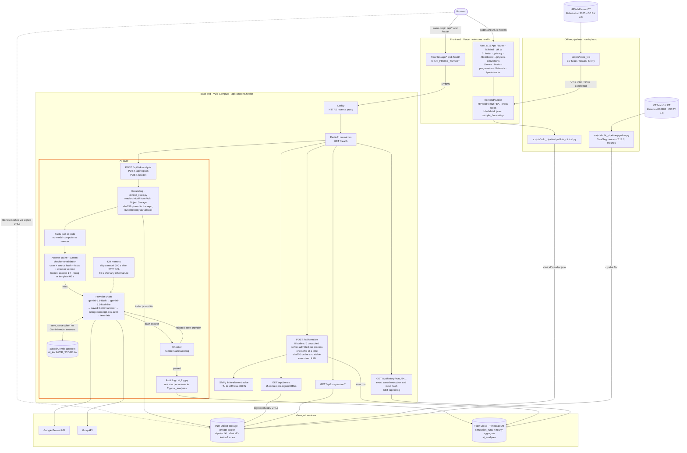
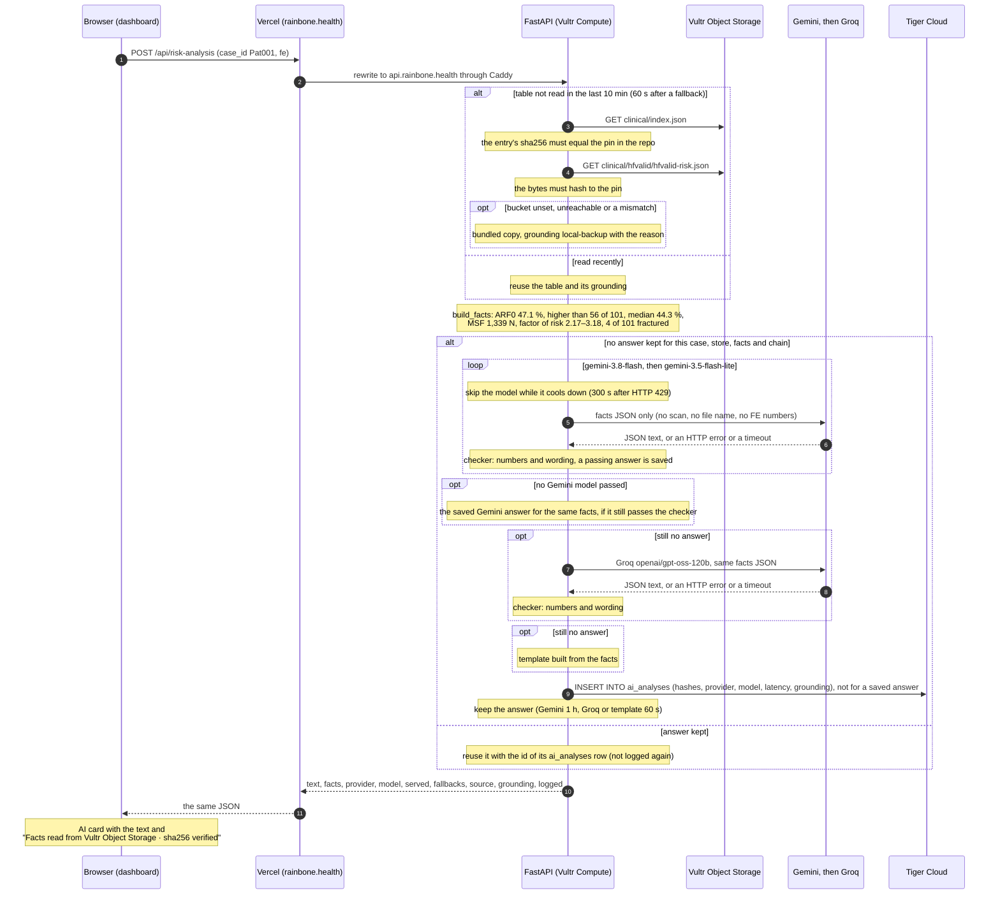

# Rainbone

**A stress test for bones, explained by AI.**

Rainbone combines CT-derived 3D models, physics simulations and AI to explore how bone
vulnerability can be made visible and understandable early enough to support prevention.

101 women had their thighbones CT-scanned. Four had a recorded fracture during follow-up.
Rainbone shows, in 3D and in colour, where a real femur takes the most strain under
load. Then Gemini explains in plain words, for the care team, where she stands among
those 101 women. Try it: <https://rainbone.health>

**The AI, in one line:** code computes and Gemini only puts the results into words. Every
number it writes is checked against the data before it's shown, its facts are read from
Vultr Object Storage with a verified sha256, and every answer a model writes is logged in Tiger Cloud.
See [The AI layer](#the-ai-layer).

## What it does

Rainbone is for care teams in senior living. The problem it targets is the fracture
from a fall: by the time a resident falls and breaks a bone, it is already an emergency.
Rainbone aims to turn a hip CT a resident already has into a fall-fracture check; today
the fall numbers come from the HFValid authors' published results, not from an uploaded
scan. It runs on one woman's femur CT from the published
HFValid study (case Pat001, age 78 at the scan): it shows the femur in 3D under an 800 N
standing load, then sets the study authors' own fall results beside it. Their absolute
risk of fracture at time 0 (ARF0), from a finite-element model coupled with a fall
model, is 47.1 % for her, higher than 56 of the 101 women (study median 44.3 %; the 4
who had a fracture during the follow-up had 53.7–73.2 %). Her minimum sideways-fall
strength (MSF) is 1,339 N, weaker than 75 of the 101, and a sideways fall hits the hip
with 2.90–4.26 kN (van den Kroonenberg 1995), or 2.17–3.18 times that strength. An AI
card words these numbers in plain language. Deterministic checks screen numerical and
clinical wording; they reduce unsupported output without proving every sentence correct.

Rainbone (RainbowBone) shows how a real bone carries load. It runs a finite-element
analysis (FEA) on a complete femur segmented from CT (60,819 tetrahedra, 17,361 nodes),
colours the bone by von Mises stress (nodal values, 0–15.83 MPa) in a 3D viewer you can
rotate and cut open, reports a standing-load stress ratio (peak stress against an assumed
150 MPa bone strength: 11 % for this femur, which is not a fracture probability), and
explains the numbers in plain language. A FastAPI back end runs the same kind of solve on
an uploaded CT volume, with each voxel's stiffness taken from its Hounsfield units. It is
a research prototype built at Hack the Valley 11, **not a medical device**: it gives no
forecast and no diagnosis, material properties and loads are assumptions, and no output
is a clinical measurement.

## Architecture



The app is live at <https://rainbone.health>. Vercel builds the front end from
`frontend/` and forwards `/api/*` and `/health` to the API (`API_PROXY_TARGET` in
`frontend/next.config.ts`), so the browser only talks to the site's own origin. The API
runs on a Vultr Compute instance at <https://api.rainbone.health>, with Caddy in front of
uvicorn. The `/bones` meshes are the one thing the browser downloads from somewhere
else: straight from the private bucket, through links the API signs.

### The AI layer

This is a fixed evidence-to-explanation workflow: retrieval, deterministic calculation,
generation, validation and provenance. It does not use autonomous clinical agents.
Ask Rainbone adds a bounded tool-using workflow: native Gemini function calls choose up to
four read-only evidence tools; a constrained writer selects approved statement IDs from their
outputs; a code critic checks that selection. The server renders exact source statements,
citations and navigation links. Unavailable native routing is explicitly labeled rules triage. The two
existing explanation cards still use checked model prose. A broader typed review brief
remains a proposal; an agent framework or vector database is not needed for known-case lookup.

All three AI endpoints run inside the FastAPI process and share provider configuration, cooldowns and
logging (`backend/services/risk.py`, `explain.py`, `ask.py`, `llm_providers.py`, `clinical_store.py`,
`ai_log.py`).

- **Grounding.** The facts are read from the private `clinical/` folder in Vultr Object
  Storage: `clinical/index.json` lists each file's sha256, which must equal the sha256
  pinned in this repository next to the bundled copy (`hfvalid-risk.json.sha256`,
  `hfvalid-femur/manifest.json.sha256`), and the file's bytes must hash to it. If the
  bucket is not configured, unreachable or does not match, the API answers from the
  bundled copy in `frontend/public/models/` and says why in `grounding`. The backup
  must also match its pin; if it does not, evidence is unavailable and generation stops.
- **Facts, not model arithmetic.** The API computes every number (ranks, median, factor
  of risk) before a model is called. The model only words them and never receives a scan
  or its file name; the risk analysis also keeps our own FE numbers away from it.
- **Provider chain.** `gemini-3.8-flash`, then `gemini-3.5-flash-lite` after an HTTP
  error such as 429, then the Gemini answer saved earlier for exactly the same facts
  (served as `served: "saved"` with its `saved_at`, and only if it still passes the
  checker), then Groq `openai/gpt-oss-120b`, then a deterministic template that needs no
  network. A Gemini key that is invalid or refused (HTTP 400, 401, 403) hands over to the
  next key in `GEMINI_API_KEYS`; a 429 is never retried with another key. `AI_CHAIN` and
  `AI_OFFLINE` change the order.
- **Checker.** Every number in an answer must be one of the facts; in the risk analysis
  it must also be its own kind of quantity (a percent only for ARF0, newtons only for
  forces, a count only for women). The risk-analysis checker also rejects ranks stated
  the wrong way round, number words (a count of women that is a fact, such as "four
  women", is read as its digits and checked), statements about the future, "chance" or
  "probability" for ARF0, diagnosis, advice, and wording that puts the recorded fracture
  at the hip, since the follow-up does not record where it was. A rejected answer moves
  on to the next provider. Checks also preserve number signs and reject supported patterns
  that bind a strength rank to ARF0 or contradict the recorded follow-up outcome.
  These checks cover explicit failure patterns, not unrestricted
  semantic verification or clinical validation; accepted prose still needs human review.
- **Answer cache and 429 memory.** An answer is kept in memory per case, grounding
  store/key/hash, facts, checker version and chain (Gemini for 1 h, Groq or template for
  60 s). A hit must pass the current checker before returning as `served: "cached"`;
  concurrent equal requests share one model call. A model that failed
  is skipped for 60 s, or 300 s after HTTP 429, by both endpoints. Eligible checked Gemini
  answers are also saved to `AI_ANSWER_STORE` when the local answer store is writable;
  this best-effort saved-answer cache outlives a restart.
- **Token meter.** Each model answer from `/api/risk-analysis` and `/api/explain` returns
  `usage`: the token counts the provider itself reported for the call that wrote it
  (Gemini `usageMetadata`, with thinking tokens counted as output; Groq `usage`), plus
  `served`. A cached answer made no new call, so the card says "Reused — no new Gemini call".
  A saved answer is served after Gemini failed or was skipped, so the card says only that it
  was reused; the template reports none. Under a live Gemini answer the card adds an
  energy and CO2e figure that is an estimate, not a measurement: Google's published median for one Gemini Apps text prompt, 0.24 Wh and
  0.03 gCO2e ([Google Cloud blog, Aug 2025](https://cloud.google.com/blog/products/infrastructure/measuring-the-environmental-impact-of-ai-inference);
  method in [arXiv:2508.15734](https://arxiv.org/abs/2508.15734)). It is shown per answer
  and never scaled by tokens, since the source gives no per-token figure. Tokens are not
  written to the audit log.
- **Audit log.** Each answer the chain produces attempts to write one row to the `ai_analyses`
  hypertable in Tiger Cloud: endpoint, case, provider, model, latency, grounding store,
  fallbacks and the sha256 of the facts and of the text. The text itself is not stored,
  and a saved Gemini answer is not logged again, since no model was called for it.
  `GET /api/ai-log` reads the latest rows. Logging is best effort: the UI says
  "Logged in Tiger Cloud" only when the API returns a confirmed log identity.

### Ask Rainbone: source statements and navigation

The header launcher (or `/` outside an input) opens a keyboard-operable overlay on every
workspace page. Both existing AI cards offer a prefilled follow-up. `POST /api/ask` accepts
`{question, case_id?: "Pat001", page?}`; questions are limited to 500 characters and pages
to the six workspace routes. Each request is independent: prior chat turns and uploaded
scans are not sent. The visible conversation lives only in page memory.

The server verifies the published risk table and the femur manifest through `clinical_store`.
Native Gemini function calls select at most four read-only evidence calls from
`get_patient_facts`, `compare_with_cohort`, `get_fea_result`, `get_page_guide` and
`get_dataset_info`. Strict argument allowlists prevent arbitrary case, file, URL or SQL access.
If native function calling fails, rules choose tools and the trace says so. A separate writer
receives only the selected tool outputs plus a fixed unsupported-request statement. Gemini,
its saved selection, Groq or a deterministic fallback selects one to three statement IDs.
A code critic permits one bounded rewrite before falling through the provider chain. The
server rejects unknown IDs, sources, routes and answers over 120 words, then renders exact
statements. The UI discloses that models select checked statements; a provider label does
not imply unrestricted generated prose. Unsupported requests get a bounded site-help response.
This limits model output to the catalogue; it does not guarantee the most relevant selection
for every question or constitute clinical validation.

Responses include `answer`, provider/model, live/cached/saved status, sources, source grounding,
confirmed Tiger log identity when available, `tools_used` and timed `trace` stages that actually
occurred. These traces arrive with the completed response; they are not streamed progress. Memory cache
keys and saved-answer identities include question/evidence hashes. The question is transient
provider input, never stored as raw text in the audit or saved-answer file. That file stores
approved IDs, while Tiger stores hashes, allowlisted tool names and processing metadata.
Migration `003_ai_tools.sql` adds the tool names without arguments or tool output. `/datasets` shows the eight
latest recorded AI answers through a GET-only card; missing audit storage is shown honestly.
It refreshes each minute while visible and never invents verification or cache status absent
from the database rows.

Limits are process-local: eight questions per transport peer per minute, four active HTTP
requests, four pending generations and 128 cached answers. Trusted reverse-proxy configuration
affects client-IP fairness. The 25-second generation deadline covers evidence reads and provider calls; native triage
has at most six seconds within it. Four evidence-worker slots stay held until real work
finishes after a timeout or disconnect. Audit writes have their existing separate 2.5-second cap. `429` includes
`Retry-After`; missing verified evidence returns `503` before a provider call.

### AI flow: one risk-analysis request



`POST /api/explain` follows the same steps with the femur model's manifest
(`clinical/hfvalid/pat001-femur-manifest.json`) instead of the HFValid table. The log
write waits at most 2.5 s and is skipped for 60 s after a failure, so a slow database
never holds up an answer for long.

### What happens when a page loads

The dashboard (`/dashboard`):

1. Next.js serves the page and the static files in `frontend/public/`.
2. The 3D viewer (`frontend/components/BoneViewer.tsx`, vtk.js) fetches
   `models/hfvalid-femur/manifest.json` and `fea-surface.vtp`: the HFValid femur with
   the stress and displacement fields that `scripts/bone_fea` solved offline. Nothing
   is solved in the browser. The cut-away view fetches `bone-fea.vtu` once and slices
   its tetrahedra in the browser (`frontend/lib/vtu-cut.ts`) to show the stress inside the bone.
3. It checks `GET /health` (and again every 15 s), posts the femur's case id to
   `POST /api/explain` for the plain-words card and to `POST /api/risk-analysis` for the
   AI fracture risk card, and reads `GET /api/history`.
4. The live engine check fetches `sample_bone.nii.gz` (a synthetic test volume, not
   anatomy) and posts it to `POST /api/simulate`. The API keeps voxels at or above
   150 HU, maps HU to stiffness, meshes the bone into tetrahedra, solves an 800 N
   compression with SfePy, and returns peak stress, mean stiffness, bone volume and the
   standing-load stress ratio. A file it has solved before (same sha256) is answered
   from memory and marked `X-Simulate-Reused: 1`. **Import scan** posts your own
   `.nii` or `.nii.gz` the same way.
5. After a real solve, the API saves the run to the `simulation_runs` hypertable in
   Tiger Cloud when `DATABASE_URL` is set. The response carries its execution `run_id`,
   `input_sha256`, original filename and `pending`, `saved` or `unavailable` persistence
   state. `GET /api/history?run_id=...` reads that exact execution back; the browser polls
   for at most five seconds and confirms a save only after matching the returned identity.
   Renaming identical contents preserves the original execution and creates no extra row.
   The hourly aggregate counts executions, not patient change.

Uploaded results appear in their own panel. The displayed reference femur, published
HFValid measures and AI cards remain Pat001; an upload does not replace them. Admission
bounds incoming bodies to eight per API process, with a 60-second body deadline (408
on timeout). That slot is released once the body arrives. Uncached solves then use a
separate three-slot running/queued limit, with one solver active at a time, released
before history persistence. Cached results bypass solve admission; the ingress cap
still applies before their contents are known. Excess requests receive HTTP 429 with
`Retry-After: 5`. Failed or busy sample runs still load earlier filename-matched history,
which is not confirmation of a new save. State is process-local, not a distributed queue.

`/physics-simulations` replays a precomputed hydraulic-press loading history of the
same femur (`models/femur-press/manifest.json` and one VTP per load step). It calls
no API.

`/bones` (Imaging library) calls `GET /api/bones`. The API reads the pelvic bone
manifest from the private Vultr Object Storage bucket and returns 15-minute pre-signed
URLs, so the browser downloads the meshes straight from the bucket without seeing any
credentials, and checks each mesh's sha256 before drawing it.

## Live routes

| Route | What it shows | API calls |
|---|---|---|
| [`/`](https://rainbone.health/) | Landing page: the HFValid femur in 3D with its solved numbers | none |
| [`/enter`](https://rainbone.health/enter) | Guest pass for the Dr. Rowan demo seat, or optional Sign in with Google (`/login` redirects here) | none |
| [`/privacy`](https://rainbone.health/privacy) | What the demo, Google sign-in and simulations store | none |
| [`/dashboard`](https://rainbone.health/dashboard) | One-screen overview: stress map and cut-away, clinical metrics, AI fracture risk card, plain-words explanation, live engine run and history | `/health`, `/api/explain`, `/api/risk-analysis`, `/api/simulate`, `/api/history` |
| [`/physics-simulations`](https://rainbone.health/physics-simulations) | Hydraulic-press replay of the same femur, with a printable missing region | none |
| [`/bones`](https://rainbone.health/bones) | Imaging library: CTPelvic1K pelvic bone meshes from Vultr Object Storage | `/api/bones`, then the bucket |
| [`/lesion-progression`](https://rainbone.health/lesion-progression) | Baseline-to-follow-up lesion annotation over eight cached 3D frames (illustrative) | `/api/progression/*` |
| [`/datasets`](https://rainbone.health/datasets) | Secure datasets: where each dataset comes from, where it is kept, what happens to an imported scan | `/health`, `/api/bones`, `/api/history` |
| [`/preferences`](https://rainbone.health/preferences) | Light, Dark, High contrast or System theme, text size and motion, saved in this browser only | none |

## API endpoints

| Method and path | What it does |
|---|---|
| `GET /health` | Liveness: `{"status": "ok", "service": "rainbowbone-fea"}` |
| `POST /api/simulate` | Multipart `file`, one `.nii` or `.nii.gz` of at most 512 MiB. Up to 8 uploads received at once (each must finish within 60 s, else 408); at most 3 uncached solves admitted per process, one running at a time; an already-solved file is answered from the cache and never refused; HTTP 429 with `Retry-After` when busy. Returns execution UUID/hash and persistence state; identical contents reuse the execution |
| `POST /api/explain` | Plain-words explanation of simulation numbers, or of `case_id` `Pat001` read from `clinical/`. AI layer |
| `POST /api/ask` | Cited reference-data and navigation answers from checked source statements; question length, rate and concurrency limits |
| `POST /api/risk-analysis` | AI-worded fracture risk analysis of one HFValid subject (`case_id`, optional `fe`) from the published table in `clinical/`. AI layer |
| `GET /api/history?limit=&source_filename=&run_id=` | Exact execution when `run_id` is supplied (takes precedence); otherwise latest or filename-filtered runs, plus hourly activity buckets |
| `GET /api/ai-log?limit=` | Latest `ai_analyses` rows: provider, model, latency, grounding store, fallbacks and hashes, without the text |
| `GET /api/bones` | CTPelvic1K manifest from the bucket with 15-minute pre-signed URLs |
| `GET /api/progression/coordinates` | Baseline and follow-up annotation points for `/lesion-progression` |
| `GET` / `HEAD /api/progression/frames/{0-7}.vtp` | The cached lesion-progression surface frames |

Request and response fields, the checker rules and the tests are in
[`backend/README.md`](backend/README.md).

## Repository layout

| Path | What it holds |
|---|---|
| `package.json` (root) | Shortcuts only: `npm run setup`, `npm run dev`, `npm run build`, `npm start` and `npm run lint` run the same scripts inside `frontend/` |
| `frontend/app/` | Next.js App Router pages: `/` (landing), `/enter` (guest pass; `/login` redirects there), `/privacy`, `/dashboard`, `/physics-simulations`, `/bones`, `/lesion-progression`, `/datasets` and `/preferences` |
| `frontend/components/` | Dashboard, `BoneViewer.tsx` (femur stress map and cut-away), `risk-analysis.tsx` and `plain-explanation.tsx` (AI cards), `CloudBones.tsx` (imaging library), `physics-simulations.tsx` and `press-viewer.tsx` (press replay), `secure-datasets.tsx`, `landing/` |
| `frontend/lib/` | API client, colour ramp, tetrahedral slicing, model numbers, preferences |
| `frontend/public/models/` | Precomputed femur FEA (`hfvalid-femur`), press steps (`femur-press`), printable reconstruction (`femur-reconstruction`) and the HFValid fracture risk table (`hfvalid-risk.json`), with sha256 pins |
| `backend/` | FastAPI app (`main.py`, `routes_*.py`), services (`services/`: solver, AI layer, storage, history) and tests. Details in [`backend/README.md`](backend/README.md) |
| `backend/migrations/` | TimescaleDB schema: `001_simulation_runs.sql` (hypertable and hourly continuous aggregate), `002_ai_analyses.sql` (AI audit log) |
| `scripts/bone_fea/` | Offline pipeline that builds `frontend/public/models/` from HFValid with 3D Slicer, TetGen and SfePy. Details in [`scripts/bone_fea/README.md`](scripts/bone_fea/README.md) |
| `scripts/vultr_pipeline/` | CTPelvic1K to TotalSegmentator to meshes in Vultr Object Storage (`pipeline.py`), and the `clinical/` upload (`publish_clinical.py`). Details in [`scripts/vultr_pipeline/README.md`](scripts/vultr_pipeline/README.md) |

## Run locally

Front end (Node.js and npm). The app lives in `frontend/`. The same commands work in PowerShell:

```bash
cd frontend
npm ci
npm run dev
```

From the repository root, `npm run setup` (once) and then `npm run dev` do the same thing.
After pulling the commit that moved the app into `frontend/`, run `npm ci` inside `frontend/`
once. The old `node_modules/` and `.next/` at the root can be deleted.

Open <http://localhost:3000>. The page calls the API at `NEXT_PUBLIC_API_BASE_URL`
(default `http://127.0.0.1:8000`). By default the API allows `http://localhost:3000`,
`https://rainbone.health` and `https://www.rainbone.health` (set `CORS_ALLOW_ORIGINS` to
change the list), so use `localhost`, not `127.0.0.1`, or the browser blocks the API calls.

Back end, in a second terminal from the repository root (tested with Python 3.12).
macOS and Linux:

```bash
cd backend
python3 -m venv .venv
source .venv/bin/activate
python -m pip install -r requirements.txt
uvicorn main:app --reload
```

Windows PowerShell:

```powershell
cd backend
py -m venv .venv
.venv\Scripts\Activate.ps1
python -m pip install -r requirements.txt
uvicorn main:app --reload
```

The API listens on `http://127.0.0.1:8000`, where the dashboard sends its calls.
Run it from a full checkout: it imports the solver from `scripts/bone_fea/`.

No keys are needed to start. Without them, both AI endpoints answer with the offline
template from the bundled copies of the facts, nothing is saved, `/api/history` and
`/api/ai-log` answer 503, and `/bones` and `/lesion-progression` have nothing to load.
To turn those on, copy `backend/.env.example` to `backend/.env`
(`Copy-Item backend\.env.example backend\.env` in PowerShell) and fill in what you need.
Never commit `.env` files. The variables, by name:

| Variables | Used for |
|---|---|
| `GEMINI_API_KEY`, `GEMINI_API_KEYS`, `GEMINI_MODEL`, `GROQ_API_KEY`, `GROQ_MODEL`, `AI_CHAIN`, `AI_OFFLINE`, `AI_ANSWER_STORE` | The AI provider chain and the saved Gemini answers |
| `DATABASE_URL` | Tiger Cloud (TimescaleDB): simulation history and the AI audit log |
| `VULTR_S3_ENDPOINT`, `VULTR_S3_ACCESS_KEY`, `VULTR_S3_SECRET_KEY`, `VULTR_S3_BUCKET` | Vultr Object Storage: `clinical/` grounding and `/api/bones` |
| `VULTR_ENDPOINT_URL`, `VULTR_BUCKET_PATH`, `AWS_ACCESS_KEY_ID`, `AWS_SECRET_ACCESS_KEY` | The lesion-progression objects (each falls back to its `VULTR_S3_*` counterpart) |
| `CORS_ALLOW_ORIGINS`, `CORS_ALLOW_ORIGIN_REGEX` | Browser origins allowed to call the API |
| `FSLDIR` | Optional FSL bone segmentation |
| `NEXT_PUBLIC_API_BASE_URL`, `API_PROXY_TARGET`, `NEXT_PUBLIC_GOOGLE_CLIENT_ID` | Front end (`frontend/.env.example`): where the browser sends API calls, where Vercel forwards `/api/*` and `/health`, and the optional Google sign-in client |

With `DATABASE_URL` set, apply the schema once with `python -m services.history migrate`
from `backend/` (it runs every file in `backend/migrations/` in order).
[`backend/README.md`](backend/README.md) covers every variable, the tests and the
optional FSL bone segmentation.

## Deploy

- **Front end:** Vercel builds the Next.js app in `frontend/`. With the Vercel CLI, run
  `vercel deploy --prod` from inside `frontend/`. A Git-linked Vercel project needs its
  Root Directory set to `frontend`. Production points `API_PROXY_TARGET` at the API and
  `NEXT_PUBLIC_API_BASE_URL` at the site itself, so API calls stay same-origin;
  `NEXT_PUBLIC_API_BASE_URL` is fixed at build time.
  `NEXT_PUBLIC_GOOGLE_CLIENT_ID` (optional, also fixed at build time) turns on "Sign in with
  Google" on `/enter`; list the site's origins as Authorized JavaScript origins on that client.
- **Back end:** any Linux host with Python 3.12. Clone the whole repository (the API imports
  the solver from `scripts/bone_fea/`), install `backend/requirements.txt`, and run
  `uvicorn main:app` from `backend/` behind an HTTPS proxy. Production runs on Vultr Compute
  with Caddy.
- **Data:** `scripts/vultr_pipeline/pipeline.py` uploads the CTPelvic1K meshes under
  `ctpelvic1k/` and `scripts/vultr_pipeline/publish_clinical.py` uploads `clinical/`;
  `backend/scripts/materialize_progression.py` uploads the cached lesion frames.

## Data and credits

| Dataset or tool | Used for | Licence |
|---|---|---|
| HFValid collection, University of Bologna | Femur CT and segmentation of Pat001; the published ARF0, MSF and follow-up of all 101 women | CC BY 4.0 |
| CTPelvic1K, sub-dataset 6 (CLINIC) | Pelvic CT for the imaging library | CC BY 4.0 |
| TotalSegmentator 2.18.0 | Bone masks and meshes of three CTPelvic1K cases | Apache-2.0 |
| van den Kroonenberg et al. 1995 | Sideways-fall impact forces, 2.90–4.26 kN | Published figures, cited |

- **HFValid** (femur CT and segmentation, case Pat001; ARF0, MSF and follow-up of every
  subject): Aldieri, La Mattina, Szyszko, Baruffaldi, Viceconti (2025). *HFValid
  collection*. University of Bologna.
  [DOI 10.6092/unibo/amsacta/8431](https://doi.org/10.6092/unibo/amsacta/8431).
  [CC BY 4.0](https://creativecommons.org/licenses/by/4.0/). Changes: Slicer
  import and export, surface reduction, tetrahedral meshing, a new illustrative FEA
  and browser visualisation; the ARF0 and MSF table is extracted from the dataset's
  published metadata (`scripts/bone_fea/build_risk_table.py`). The follow-up records
  whether a subject had a fracture, not where.
- **CTPelvic1K** (pelvic CT): Liu P. et al. Deep Learning to Segment Pelvic
  Bones: Large-scale CT Datasets and Baseline Models. IJCARS (2021). Zenodo record
  [4588403](https://zenodo.org/records/4588403),
  [DOI 10.5281/zenodo.4588403](https://doi.org/10.5281/zenodo.4588403).
  [CC BY 4.0](https://creativecommons.org/licenses/by/4.0/). The masks and meshes are
  derived from the CT by automatic segmentation.
- **TotalSegmentator** 2.18.0: Wasserthal J. et al. Radiology:
  Artificial Intelligence (2023),
  [DOI 10.1148/ryai.230024](https://doi.org/10.1148/ryai.230024). Apache-2.0.
- **Sideways-fall forces:** van den Kroonenberg A.J. et al. (1995),
  [PubMed 8618384](https://pubmed.ncbi.nlm.nih.gov/8618384/).

## Limitations

- **A research prototype, not a medical device.** The fracture-risk figure it surfaces early
  (ARF0) is the HFValid authors' published model estimate for this femur, shown so a care team
  can see where she stands among 101 women before a fall. Rainbone makes no forecast of its own
  and no diagnosis, and nothing in it has been validated for clinical use.
- **The fall numbers are published, not computed from a scan.** ARF0 and MSF are the
  HFValid authors' results for one case, Pat001. Importing a CT runs our standing-load
  solve; it does not produce an ARF0 or an MSF.
- **Our FEA is illustrative.** One uniform, uncalibrated Young's modulus (10 GPa,
  ν 0.3), a clamped distal end and 800 N on the femoral head: a standing load, not a
  fall. The 11 % stress ratio divides peak stress by an assumed 150 MPa strength and is
  not a fracture probability. The press replay's damage model is not calibrated either.
- **A small cohort.** The ranks compare one woman with 101, of whom 4 had a fracture
  during the follow-up.
- **The AI words facts; it does not judge them.** The checker catches wrong numbers and
  blocked wording with rules, not by understanding the text, and when the model quotas
  run out the card falls back to Groq or to the template.
- **Lesion progression is a visualization demo.** Its intermediate frames and metrics
  are illustrative placeholders, not measured progression.
- **No server accounts.** The clinician in the header is a demo profile; Google sign-in,
  when it is on, keeps the name, email and photo in the browser only. `GET /api/history`
  and `GET /api/ai-log` are readable by anyone. History stores the file name exactly as
  sent, so name files without patient details.
- **One solve at a time,** every in-memory cache belongs to one API process, and the
  saved-answer file assumes a single server process.

## Team

Built at Hack the Valley 11 by Galit Tauber, Camila Rojas, Jisara Wuttikreekiat and
Marco Anthony Ayuste.
